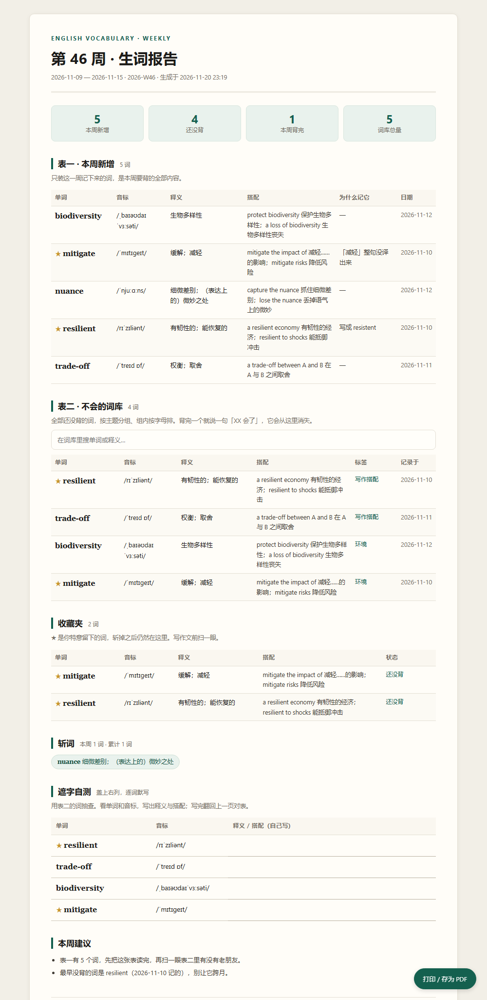
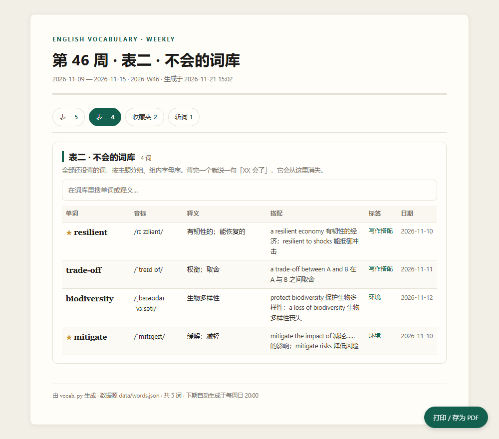

# vocab-ledger

**Let your AI agent keep a vocabulary ledger.**

> When your AI grades an English exercise — an essay, a translation, a dictation, a cloze test —
> the words you didn't know get written into a local JSON file.
> You review them as masked flashcards in the browser, mark two states, and print a one-page report every week.

- **No account, no server, no telemetry.** The data is a JSON file on your disk.
- **Python 3.10+, zero dependencies.**
- **Protocol-first**: [`SPEC.md`](SPEC.md) is the product; `vocab.py` is just one implementation.



---

## The three things you actually do

### 1. Hand in homework

Paste your text to your AI, ask it to grade it. It writes the unknown words into `data/words.json`,
including *why* each word was recorded ("wrote `australian` instead of `astronaut`").

You do nothing else.

### 2. Review

```bash
python vocab.py app --open
```

A local page at `http://127.0.0.1:8765/`:

- answers are **hidden** — click a card to reveal meaning, collocations, examples
- **☆ star** = "I want this for writing" (kept in favourites, even after killing)
- **斩 (kill)** = "I know this now" (leaves the queue)
- keyboard: `1` star, `2` kill
- five tabs: Study / This week / Library / Favourites / Killed

### 3. Print

Every Sunday at 20:00 a report is generated automatically. Missed it? The first login afterwards catches up.

```bash
python vocab.py report --open
```

One HTML file, five switchable views; `Ctrl+P` prints the active one.



---

## Install

```bash
git clone https://github.com/hexiegzm/vocab-ledger.git
cd vocab-ledger
python vocab.py add --file examples/words.sample.json
python vocab.py app --open
```

On Windows: clone it, then **double-click `背词.cmd`** (it launches with `pythonw.exe`, so no console window).
If Python is missing or too old, the script stops and tells you what to fix instead of failing silently.

---

## Commands

```bash
python vocab.py add --file seed/week47.json      # batch import (idempotent)
python vocab.py add resilient --zh 有韧性的 --kind 拼写 --note "wrote resistent"
python vocab.py learn resilient                  # kill (alias: kill)
python vocab.py unlearn resilient                # put it back
python vocab.py star resilient                   # add to favourites
python vocab.py list --starred                   # favourites
python vocab.py stats                            # summary
python vocab.py app --open                       # study page
python vocab.py report --open                    # weekly report
python vocab.py weekly                           # catch up + current week (idempotent, for schedulers)
python vocab.py doctor --task MyTask             # self-check
```

`--kind` is one of `拼写` (spelling) / `搭配` (collocation) / `词义` (meaning) / `语法` (grammar) / `眼生` (unfamiliar).
The weekly report shows the breakdown, so you can see *where* you keep failing.

---

## For AI agents

This repo is half a tool, half a protocol. Any agent that reads project instructions can use it:

| File | Purpose |
|---|---|
| [`AGENTS.md`](AGENTS.md) | The contract: what to record, how to write the note, what not to touch |
| [`CLAUDE.md`](CLAUDE.md) | Same, for Claude Code (it reads this name instead) |
| [`.github/copilot-instructions.md`](.github/copilot-instructions.md) | Same, for GitHub Copilot |
| [`prompts/universal.md`](prompts/universal.md) | For chat-only models: a prompt that returns SPEC-shaped JSON you paste in |

Works with Codex CLI, DSH, Cursor, Gemini CLI, Claude Code, Copilot. Anything that can run a command, really.

---

## Design notes

**There is no score, no mastery level, no spaced-repetition schedule.**

Scoring requires a *quiz loop* — something has to ask you questions and record right/wrong.
That loop doesn't exist in this workflow: you write, an AI grades, you read. Without quizzes there are no
"correct" events, so the score stays at zero forever and the list never shrinks.

So the ledger tracks only what is actually observable: **not yet reviewed** / **reviewed**, plus an
independent **starred** flag. Judgement stays with the human; the script only records and renders.

Two more decisions:

- **Local HTML, not localStorage.** A static file can't write to disk. Buttons write to `words.json`
  through a local server bound to `127.0.0.1`, so there is exactly one source of truth.
- **Scheduling lives in the OS** (cron / Task Scheduler / launchd). The script never starts a timer.

---

## Privacy

No network. No account. No telemetry. Your vocabulary is private — it reveals your level, your field,
what you read. Not uploading it is a design goal, not a missing feature.

## License

MIT
