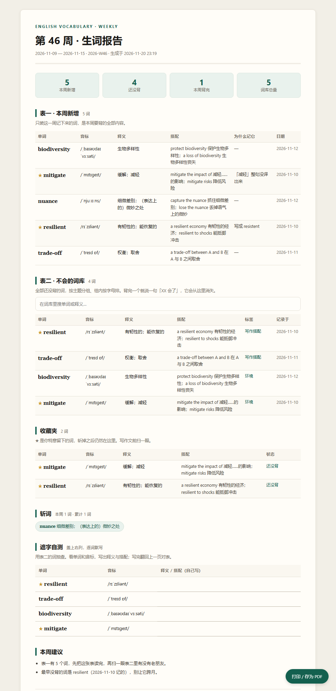
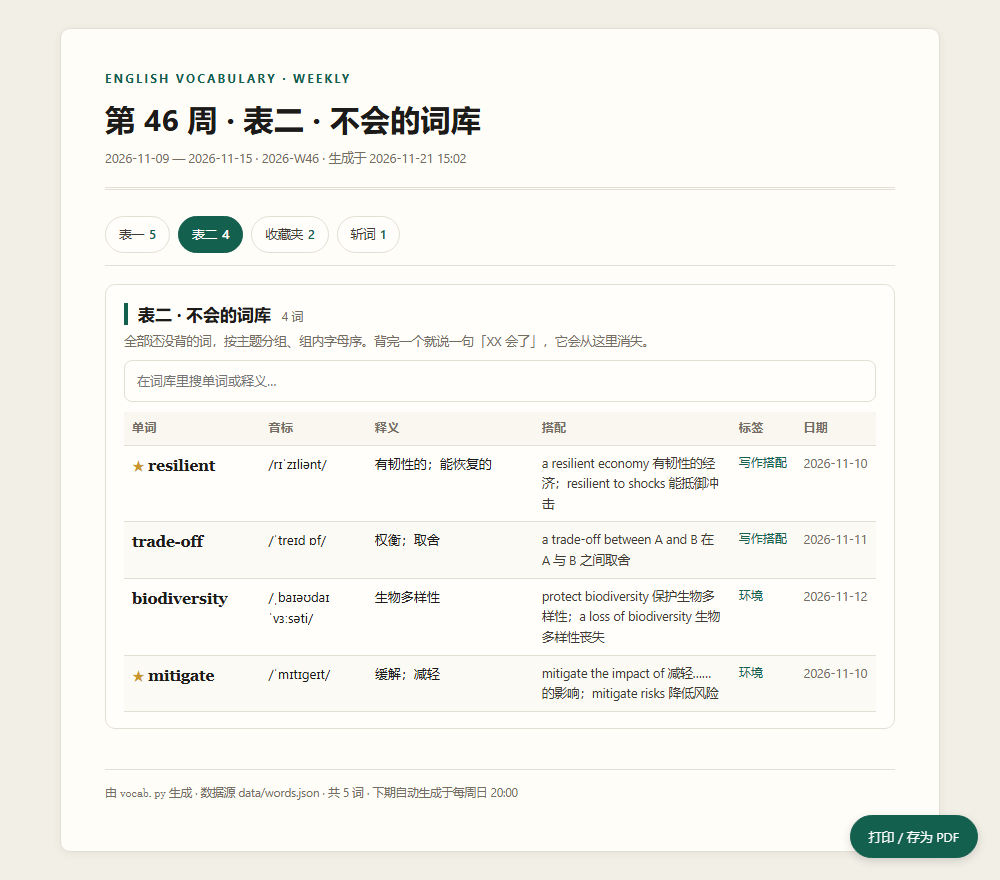

# vocab-ledger · 让 AI 把「你不会什么」记下来


> AI 批改完你的英语作业（作文、翻译、听写、完形、阅读都算），顺手把不会的词写进一个本地 JSON；
> 之后你在浏览器里一张张背，点两个按钮就能处理掉。
>
> 不需要账号，不联网，数据在你自己硬盘上。



---

## 为什么做这个

用 Anki 的人多半死在「录入」上，不是死在复习算法上。看见生词 → 建卡 → 填释义 → 加标签 → 选牌组，三次之后就懒得动了。

而 AI 批改作业的那一刻，**词、错因、上下文全都在场**，录入的边际成本几乎为零。

所以取舍很明确：**把录入成本压到零，复习端能省则省。**

三条判断贯穿整个设计：

1. **录入发生在批改当场**，而且是 AI 做，不是人做。人只负责背。
2. **复习按周批量发生**，一次看一批，不是每天弹通知。
3. **AI 判断，脚本干活**。AI 决定「哪些词值得记」和「错在哪」，脚本负责存储、排序、渲染。这条边界让整个东西可以离线跑——AI 不在，数据还在。

## 30 秒上手

只需要 Python 3.10+，没有第三方依赖。

```bash
git clone https://github.com/hexiegzm/vocab-ledger.git
cd vocab-ledger

# 导入示例数据
python vocab.py add --file examples/words.sample.json

# 打开背词页（带按钮，能直接操作）
python vocab.py app --open
```

浏览器会打开 `http://127.0.0.1:8765/`，一张张卡片，点卡片看答案，点按钮斩或收藏。

想先看周报长什么样：

```bash
python vocab.py report --open
```

清空示例数据后就是一本空账本：

```bash
rm -rf data reports logs
```

## 它怎么工作

```
你交作业
   │
   ▼
AI 批改 ──► add：不认识的词 + 音标 + 释义 + 搭配 + 为什么记它
   │
   ▼
data/words.json     唯一数据源：纯文本、可手改、可 diff、自动备份
   │
   ├──► app（背词页）── 点「斩」/「☆ 收藏」──► 写回同一个 JSON
   │
   └──► 每周日 ──► 单文件 HTML ──► 打印
```

整个环里唯一的「智能」在第一环——判断哪些词值得记。后面全是死规则，所以它可以一直跑、可复现、换模型也不变形。

## 两个动作：斩 / 收藏

一个词只有两种状态，外加一个独立标记：

```
   add                learn（别名 kill）
 ∅ ───► 还没背 ─────────────► 背过了
          ▲                      │
          └──────── unlearn ─────┘

   star / unstar  ── 收藏夹，与上面这条线互不影响
```

| 动作 | 含义 | 效果 |
|---|---|---|
| **斩**（`learn`） | 背过了 | 从待背清单移走，进「斩词」，可以 `unlearn` 放回 |
| **收藏**（`star`） | 写作时能用，想留着 | 进收藏夹，**斩了也还在** |

两者互相独立，四种组合都成立。为什么不算分：评分需要「答题」这个动作来喂数据，而实际流程里没有答题环节——没有测验就没有正确答案，分数会永远停在 0，清单永远不缩小。

## 五个视图，一个 HTML

`report` 生成的是一个文件，里面五个可切换的视图：

| 视图 | 内容 | 特点 |
|---|---|---|
| **背词** | 待背的词 | **遮挡**：只显示单词和音标，点卡片揭晓释义、搭配、例句、错因；打印时自动展开 |
| **表一 · 本周新增** | 本周 `first_seen` 的词 | 带「当初为什么记它」，顶部有错因分布（拼写 / 搭配 / 词义 / 语法 / 眼生） |
| **表二 · 不会的词库** | 全部还没背的词 | 带标签和记录日期，可搜索 |
| **收藏夹** | ★ 过的词 | 标着「斩了 / 还没背」 |
| **斩词** | 已斩的词 | 按「斩于」倒序 |

- 顶部标签带实时计数，右侧搜索框只过滤当前视图
- 全是卡片，没有表格
- 打印时只打印当前视图——五个视图可以各打一张

> 本周一条都没记的话，`report` 会自动退回到最近有数据的一周，不会给你一张空表。



## 命令

```bash
# 录入
python vocab.py add --file seed/week47.json          # 批量（幂等，重复导入不会重复记）
python vocab.py add resilient --zh 有韧性的 --tag 写作搭配 --kind 拼写 --note "写成 resistent"

# 处理
python vocab.py learn resilient     # 斩（别名 kill）
python vocab.py unlearn resilient   # 放回
python vocab.py star resilient      # 收藏
python vocab.py unstar resilient

# 查看
python vocab.py list                # 还没背的
python vocab.py list --learned      # 斩过的
python vocab.py list --starred      # 收藏夹
python vocab.py stats               # 总账
python vocab.py weeks               # 按周统计新增

# 界面
python vocab.py app --open          # 背词页（review 是同一个命令的别名）
python vocab.py report --open       # 生成并打开周报
python vocab.py report --week 2026-W46 --open
python vocab.py weekly              # 补漏 + 出当周（幂等，给调度用）
python vocab.py doctor --task VocabLedgerWeekly   # 自检
```

`app` 只监听 `127.0.0.1`：点按钮**直接写 `data/words.json`**，同时重新生成当周 HTML。标签页关掉 30 分钟后服务自动退出（`--idle 0` 可关闭）。

**服务只服务于「点按钮」。** AI 记录用的是独立的一次 `add` 调用，周日报告是计划任务跑的，两者都不需要这个服务在跑。Windows 上想彻底没有黑窗口，用 `pythonw.exe` 启动即可。

## 让 AI 帮你记

这是这个仓库的重点。**它一半是工具，一半是协议。**

| 文件 | 作用 |
|---|---|
| [`AGENTS.md`](AGENTS.md) | 仓库内的工作约定。`AGENTS.md` 是跨工具的事实标准，Codex、DSH、Cursor 等直接读 |
| [`CLAUDE.md`](CLAUDE.md) | 给 Claude Code 的入口（它默认读这个名字），用 `@AGENTS.md` 引用，不重复维护 |
| [`.github/copilot-instructions.md`](.github/copilot-instructions.md) | 给 GitHub Copilot 的入口 |
| [`skills/vocab-ledger/SKILL.md`](skills/vocab-ledger/SKILL.md) | 同一套流程的 skill 版，让 AI 在**任何对话**里都能想起「该记账了」 |
| [`prompts/universal.md`](prompts/universal.md) | 给**不能读写文件**的 AI（豆包、网页版 ChatGPT）——一段提示词，让它输出符合 SPEC 的 JSON，你贴一次即可入库 |
| [`SPEC.md`](SPEC.md) | 协议本体：字段、状态、渲染契约。换语言实现对照这份 |

### 哪些 AI 能自动记

| 工具 | 自动记录 | 说明 |
|---|---|---|
| Codex CLI / DSH / Cursor / Gemini CLI | ✅ | 读 `AGENTS.md` |
| Claude Code | ✅ | 读 `CLAUDE.md` |
| GitHub Copilot | ✅ | 读 `.github/copilot-instructions.md` |
| 豆包 / 网页版 ChatGPT / Kimi | ⚠️ 半自动 | 没有本地文件与终端权限，用 `prompts/universal.md`，贴一次即可 |
| 手机 App | ❌ | 同上，且没有命令行 |

最后两行不是配置问题，是权限模型问题。但**半自动和全自动产出的账本完全一样**——区别只是「复制粘贴一次」。

典型的一轮对话：

> **你**：`（贴一篇英语作文）` 帮我改改。
>
> **AI**：`（批改，指出 6 处问题）` 记了 5 个新词、2 条错因。最该先背：resilient（写成 resistent）、mitigate（「减轻」整句没译出来）。周报里会出现在「写作搭配」和「环境」两组。

注意最后那句话——**账本里多了东西**，而不是聊完就散。

## 每周自动出报告

调度不在脚本里，交给系统：cron / Windows 计划任务 / launchd。

```bash
# Linux / macOS：每周日 20:00
0 20 * * 0 cd /path/to/vocab-ledger && python vocab.py weekly --open
```

`weekly` 是幂等的：它只生成「已经过了周日 20:00、但还没生成」的那些周。所以可以放心绑两个触发器：

- **每周日 20:00**：正常出本周报告
- **每次登录**：检查有没有漏掉的周，有就补上

这样「周日没开机」不再是问题：下次开机那次会把漏掉的周补出来。

Windows / macOS 的写法见 [docs/scheduling.md](docs/scheduling.md)。

**不确定它到底跑没跑？**

```
$ python vocab.py doctor --task VocabLedgerWeekly
生词账本自检 · /path/to/vocab-ledger
────────────────────────────────────────────────────────
✓ Python       3.12.4
✓ 数据文件     data/words.json  (13.0 KB)
✓ 词库         42 个词（还没背 17 / 背过 25）
✓ 最近出报告   2026-11-22 20:00（2026-W47，20 词，2 天前）
✓ 计划任务     VocabLedgerWeekly  Ready  下次 2026-11-29 20:00  上次 2026-11-22 20:00  exit=0
────────────────────────────────────────────────────────
一切正常。
```

报告每次生成都会写一个心跳（`logs/last-report.json`），`doctor` 靠它判断「调度还活着吗」，而不是靠你回想。

## 隐私

- **不联网**。除了 `git clone`，它不会发出任何请求（`app` 只监听 `127.0.0.1`）。
- **无账号、无遥测、无云同步。**
- 数据是一个你能用记事本打开的 JSON，摆在你自己的硬盘上。

生词库挺私人的——它暴露你的水平、职业方向和阅读兴趣。所以「不上传」不是缺功能，是设计目标。

## 不做什么（Non-goals）

- ❌ 间隔重复调度器（没有难度系数、没有复习曲线）
- ❌ 出题与判分（遮挡是你自己点开的，它不测你）
- ❌ 手机 App、账号体系、云同步
- ❌ 音标/释义的自动抓取（AI 在场时由 AI 填，不在时留空）

## 目录

```
vocab-ledger/
├─ vocab.py                     参考实现（零依赖，单文件）
├─ SPEC.md                      协议：字段、状态、渲染契约
├─ AGENTS.md                    给 AI 的仓库内约定
├─ CLAUDE.md                    Claude Code 入口（引用 AGENTS.md）
├─ skills/vocab-ledger/SKILL.md 同一流程的 skill 版
├─ prompts/universal.md         给不能读写文件的 AI 用的提示词
├─ examples/words.sample.json   可直接导入的样例
├─ docs/                        调度说明、预览图
└─ tests/                       48 个标准库单元测试
```

## 开发

```bash
python -m unittest discover -s tests -v     # 零依赖，不用装 pytest
```

## 协议优先

这个项目的第一交付物是 [SPEC.md](SPEC.md)，不是 `vocab.py`。

任何语言、任何工具，只要满足规格，就能读写同一本账本、渲染出同一种报告。欢迎其他实现——用 Node 写个渲染器、用 Go 写个 CLI、给 Obsidian 写个插件来读 `words.json`，都算这个项目的一部分。

参考实现只是其中之一。

## License

MIT
